# Website nghe nhạc trực tuyến

Dự án xây dựng website nghe nhạc và quản lý thư viện âm nhạc, gồm backend Spring Boot và frontend React. Người dùng có thể tìm kiếm, xem thông tin bài hát/nghệ sĩ/album và phát nhạc trên trình duyệt. Hệ thống còn có các thành phần quản lý playlist, yêu thích, tài khoản và nội dung âm nhạc.

Tài liệu này giới thiệu dự án và tập hợp **11 sơ đồ phân tích, thiết kế bằng Mermaid**. Nội dung được tái dựng từ mã nguồn ngày 15/10/2026; các phần **hiện trạng** và **đề xuất** được đánh dấu riêng. Chưa xác nhận mọi chức năng đã chạy hoàn chỉnh.

## Công nghệ sử dụng

| Thành phần | Công nghệ |
|---|---|
| Backend | Java 17, Spring Boot 3.2.2, Maven |
| Cơ sở dữ liệu | MySQL, Spring Data JPA/Hibernate |
| Xác thực và phân quyền | Spring Security, JWT/JJWT, BCrypt |
| Biểu diễn API | REST, Spring HATEOAS, MapStruct ở một số DTO |
| Frontend | React 18, TypeScript 5, Vite 5 |
| Giao diện | Tailwind CSS 3, React Icons, React Slick, React Hot Toast |
| Điều hướng và trạng thái | React Router 6, Redux Toolkit, Auth Context |
| Kết nối API | Axios |

## Cấu trúc hai repository

README này nằm trong **repository backend**. Frontend là repository riêng, được đặt cạnh backend trong workspace hiện tại:

```text
workspace/
├── do_an_tot_nghiep/                   # Backend — repository chứa README này
│   ├── README.md
│   ├── pom.xml
│   ├── mvnw, mvnw.cmd, .mvn/
│   └── src/
│       ├── main/
│       │   ├── java/com/phuc158965/do_an_tot_nghiep/
│       │   │   ├── controller/
│       │   │   ├── service/impl/
│       │   │   ├── repository/
│       │   │   ├── entity/
│       │   │   ├── dto/
│       │   │   ├── mapper/impl/
│       │   │   ├── security/config/
│       │   │   ├── config/
│       │   │   └── exception/
│       │   └── resources/application.properties
│       └── test/java/...
└── FontEndDoAnTotNghiep/                # Frontend — repository riêng
    ├── package.json
    ├── vite.config.ts
    └── src/
        ├── main.tsx, App.tsx, router.ts
        ├── pages/admin_pages/
        ├── components/
        ├── server/                     # Client gọi API, không phải backend
        ├── models/, types/
        ├── hooks/
        └── store/playingMusic/
```

## Hướng dẫn chạy môi trường phát triển

### Backend

Chuẩn bị Java 17, MySQL, database `do_an_tot_nghiep` và thông tin kết nối phù hợp trong `src/main/resources/application.properties`. Backend được cấu hình port **8888**, MySQL port **3306**; host database lấy từ `MYSQL_HOST` hoặc mặc định `localhost`.

Chạy trong thư mục repository backend:

```bash
bash mvnw spring-boot:run
```

Lệnh kiểm tra và đóng gói:

```bash
bash mvnw test
bash mvnw package
```

Maven Wrapper cần tải dependency nếu máy chưa có cache. Test hiện tại dùng `@SpringBootTest` và có thể cần database. Cấu hình `ddl-auto=update` có thể thay đổi schema khi khởi động; sử dụng database phát triển. Chưa có bộ dữ liệu mẫu được xác nhận trong repository.

### Frontend

Chuẩn bị Node.js/npm tương thích với phiên bản Vite khai báo trong frontend. Trong repository `FontEndDoAnTotNghiep`:

```bash
npm ci
npm run dev
```

Vite mặc định dùng port **5173** khi cổng khả dụng. Axios hiện gọi `http://localhost:8888/api/`; backend cấu hình CORS cho frontend localhost:5173. Khi thay đổi host/port, cần cập nhật cấu hình tương ứng ở cả hai phía.

Kiểm tra frontend:

```bash
npm run build
npm run lint
```

Các lệnh trên được tổng hợp từ cấu hình dự án; chưa được chạy để xác nhận trong lần viết tài liệu này.

## Nội dung phân tích và thiết kế

1. Giới thiệu đề tài và phạm vi chức năng.
2. Tác nhân, use case, ma trận quyền và yêu cầu nghiệp vụ.
3. Đặc tả các use case chính.
4. Kiến trúc, phân rã chức năng và triển khai.
5. ERD, bảng nối và sơ đồ lớp.
6. Luồng đăng nhập, nghe nhạc, playlist và quản lý bài hát.
7. Thiết kế giao diện và điều hướng.
8. Yêu cầu phi chức năng và API đề xuất.
9. Kịch bản kiểm thử, thứ tự hoàn thiện.
10. Gợi ý bố cục báo cáo đồ án.

**Xem sơ đồ:** mở README trong trình đọc Markdown hỗ trợ Mermaid, chẳng hạn trang repository trên GitHub. Mỗi khối `mermaid` là mã nguồn sơ đồ có thể chỉnh sửa. Sơ đồ use case dùng flowchart để biểu diễn chức năng và tác nhân, không phải ký pháp UML use case đầy đủ.

---

## 1. Giới thiệu đề tài

Hệ thống cung cấp môi trường nghe nhạc trên trình duyệt, cho phép người dùng tìm kiếm bài hát, xem thông tin nghệ sĩ và album, phát nhạc và tổ chức thư viện cá nhân. Người quản lý nội dung cập nhật danh mục âm nhạc; quản trị viên thực hiện các thao tác quản trị theo quyền được cấp.

Mục tiêu của đề tài là xây dựng một ứng dụng web có giao diện người dùng và quản trị, kết nối với REST API và cơ sở dữ liệu quan hệ. Hệ thống đồng thời minh họa cách tổ chức ứng dụng theo tầng, xác thực bằng JWT, phân quyền theo vai trò và quản lý các quan hệ nhiều–nhiều trong dữ liệu âm nhạc.

### 1.1. Phạm vi

- Danh mục bài hát, nghệ sĩ, album và thể loại.
- Tìm kiếm theo tên bài hát, nghệ sĩ, album; xem chi tiết và danh sách phân trang.
- Đăng ký, đăng nhập và quản lý thông tin tài khoản.
- Phát/tạm dừng và tua nhạc từ URL của bài hát.
- Tạo, chỉnh sửa playlist; thêm hoặc bỏ bài hát khỏi playlist.
- Quản lý danh sách bài hát yêu thích.
- Quản trị bài hát, nghệ sĩ và album.
- Bình luận là phần mở rộng: có mô hình dữ liệu, chưa có chức năng CRUD hoàn chỉnh.

Không đưa thanh toán, gói thuê bao, gợi ý bằng học máy, đồng bộ lời bài hát, tải nhạc ngoại tuyến hoặc xử lý âm thanh chuyên dụng vào phạm vi cốt lõi. Các tên giao diện như “trending”, “recommend” và “charts” chưa đủ chứng minh có thuật toán gợi ý hoặc bảng xếp hạng theo lượt nghe.

### 1.2. Mức độ thể hiện trong mã nguồn

| Nhóm chức năng | Hiện trạng | Phần cần hoàn thiện/xác minh |
|---|---|---|
| Đăng nhập | Có API, form, AuthProvider và JWT | Đồng bộ token, lỗi đăng nhập, hết hạn/logout |
| Đăng ký | Có API signup và trang giao diện | Component SignUp chưa nối API; bổ sung validation |
| Danh mục và tìm kiếm | Có API và các trang liên quan | Kiểm thử dữ liệu, phân trang và trạng thái rỗng |
| Phát nhạc | Có HTML audio, play/pause, tua | Đồng bộ state; xác minh URL âm thanh thực tế |
| Quản lý song/artist/album | Có API và giao diện CRUD | Guard quản trị, quyền thao tác, validation |
| Playlist | Có API và menu thêm bài | Menu dùng user ID cố định; nút tạo chưa có handler |
| Yêu thích | Có backend và service frontend | Tham số ID/token chưa thống nhất |
| Tài khoản/kích hoạt | Có API | Phân quyền hiện tại quá rộng; UI quản trị chưa được xác nhận |
| Thể loại | Có entity/API, thành phần chọn thể loại | Chưa thấy bộ trang quản trị riêng tương đương song/artist/album |
| Bình luận | Có entity, service, repository; API đọc theo bài hát | CommentController còn rỗng |

## 2. Tác nhân và yêu cầu nghiệp vụ

### 2.1. Tác nhân

| Tác nhân | Mô tả và trách nhiệm trong thiết kế đề xuất |
|---|---|
| Khách | Người chưa đăng nhập; đăng ký và đăng nhập |
| Thành viên — CUSTOMER | Xem/tìm nhạc, nghe nhạc, quản lý playlist và yêu thích của mình |
| Người quản lý nội dung — MANAGER | Xem danh mục, thêm/sửa bài hát, nghệ sĩ và album |
| Quản trị viên — ADMIN | Xem/thêm/sửa/xóa danh mục; quản trị trạng thái tài khoản |

Backend hiện yêu cầu đăng nhập để đọc songs/artists/albums. Vì vậy bản thiết kế mặc định không cho khách duyệt danh mục công khai. Nếu muốn cho nghe thử hoặc duyệt tự do, đó là thay đổi yêu cầu và cấu hình quyền.

### 2.2. Sơ đồ use case tổng quát — đề xuất

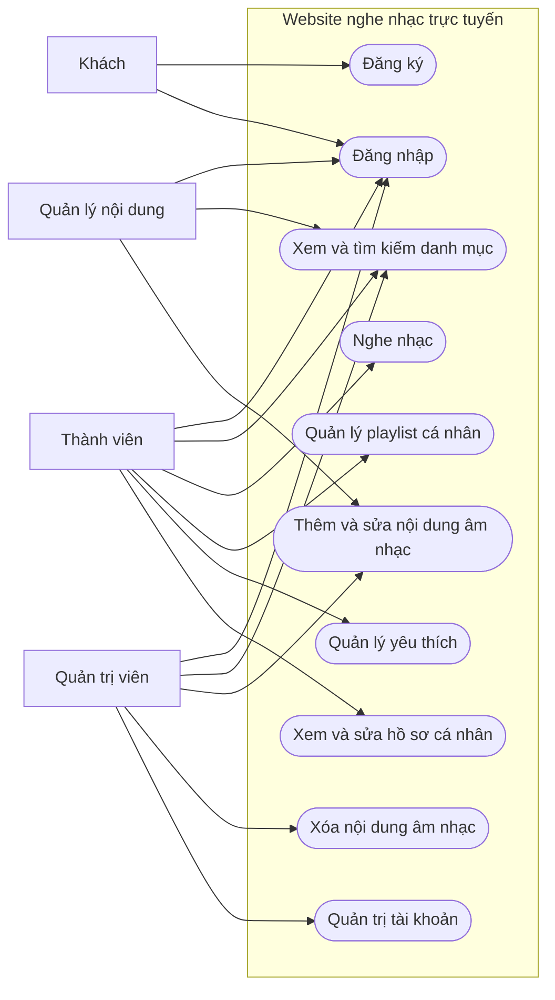

Sơ đồ không mô hình hóa kế thừa vai trò: code hiện chưa cho ADMIN/MANAGER mọi quyền playlist của CUSTOMER. Quyền nghe nhạc của MANAGER/ADMIN có thể dùng chung giao diện đọc bài hát; sơ đồ chỉ nhấn mạnh nhiệm vụ chính của từng tác nhân.

### 2.3. Ma trận quyền mục tiêu

| Chức năng | Khách | CUSTOMER | MANAGER | ADMIN |
|---|:---:|:---:|:---:|:---:|
| Đăng ký tài khoản CUSTOMER | Có | — | — | — |
| Đăng nhập | Có | Có | Có | Có |
| Xem/tìm kiếm/nghe nhạc | Không | Có | Có | Có |
| Playlist cá nhân | Không | Có | Chưa mở rộng | Chưa mở rộng |
| Yêu thích cá nhân | Không | Có | Có | Có |
| Sửa hồ sơ bản thân | Không | Có | Có | Có |
| Thêm/sửa song, artist, album | Không | Không | Có | Có |
| Xóa song, artist, album | Không | Không | Không | Có |
| Quản trị tài khoản | Không | Không | Không | Có |

Ma trận là mục tiêu nghiệp vụ, không mô tả đầy đủ cấu hình bảo mật hiện tại. Đặc biệt `/api/users/**` và `/api/accounts/**` đang được mở rộng bằng permitAll; cần sửa để đạt ma trận này. Quyền CRUD thể loại cần được quy định bổ sung; hiện chưa có matcher phân quyền chuyên biệt tương đương song/artist/album.

### 2.4. Yêu cầu chức năng

| Mã | Yêu cầu |
|---|---|
| FR01 | Đăng ký tài khoản thường, kiểm tra thông tin bắt buộc và trùng tên đăng nhập |
| FR02 | Xác thực tài khoản hợp lệ, đang hoạt động; cấp và sử dụng JWT |
| FR03 | Xem danh sách/chi tiết bài hát, nghệ sĩ, album và thể loại |
| FR04 | Tìm kiếm bài hát/nghệ sĩ/album theo tên; phân trang kết quả |
| FR05 | Phát, tạm dừng, tua bài hát; hiển thị thời lượng và thời điểm phát |
| FR06 | Tạo, đổi tên, xóa playlist; thêm/bỏ bài hát trong playlist của chính mình |
| FR07 | Thêm/bỏ bài hát yêu thích; xem danh sách yêu thích cá nhân |
| FR08 | Xem và cập nhật hồ sơ của tài khoản hiện hành |
| FR09 | Quản lý nội dung song/artist/album theo quyền |
| FR10 | Quản trị trạng thái tài khoản; chặn người không có quyền thực hiện thao tác quản trị |
| FR11 | Thông báo rõ khi không có kết quả, không đủ quyền, dữ liệu sai hoặc kết nối thất bại |

Các FR là yêu cầu mục tiêu; xem bảng hiện trạng ở mục 1.2 trước khi khẳng định chức năng đã hoàn thành.

### 2.5. Quy tắc nghiệp vụ đề xuất

1. Đăng ký công khai chỉ cấp CUSTOMER. Vai trò cao hơn phải được cấp qua quy trình quản trị.
2. Tài khoản vô hiệu hóa không được đăng nhập; chính sách xử lý JWT đã cấp cần được quy định và kiểm thử.
3. Mỗi playlist có một chủ sở hữu; chỉ chủ sở hữu được sửa danh sách của mình.
4. Không thêm trùng một bài hát vào cùng playlist hoặc danh sách yêu thích.
5. Một người dùng có tối đa một danh sách yêu thích; có thể khởi tạo khi đăng ký hoặc lần sử dụng đầu tiên.
6. Khi xóa bài hát, xử lý bảng nối và bình luận theo chính sách nhất quán, không xóa lan user/nghệ sĩ.
7. Số lượng track phải khớp danh sách thực tế; ưu tiên tính từ dữ liệu thay vì lưu dư thừa nếu chưa cần tối ưu.
8. URL nhạc và ảnh phải hợp lệ theo định dạng cho phép. API metadata không bảo đảm URL bên ngoài luôn truy cập được.

## 3. Đặc tả các use case chính

### UC01 — Đăng nhập

- **Tác nhân:** người có tài khoản.
- **Tiền điều kiện:** tài khoản đã tồn tại và đang hoạt động.
- **Luồng chính:** nhập username/password → gửi API signin → xác thực BCrypt và trạng thái tài khoản → trả JWT và quyền → lưu phiên phía trình duyệt → chuyển vào hệ thống.
- **Ngoại lệ mục tiêu:** thiếu dữ liệu; sai thông tin; tài khoản bị khóa; lỗi mạng. Giao diện giữ nguyên form và hiển thị thông báo phù hợp.
- **Hậu điều kiện:** request sau đó gửi Bearer token; không trả password/hash cho trình duyệt.
- **Khoảng cách hiện trạng:** LoginService có thể chuyển HTTP lỗi thành promise thành công; refresh token được cấp nhưng chưa thấy endpoint refresh.

### UC02 — Tìm kiếm và nghe nhạc

- **Tác nhân:** người đã đăng nhập có quyền đọc nhạc.
- **Tiền điều kiện:** có bài hát và URL âm thanh truy cập được.
- **Luồng chính:** nhập từ khóa → lấy kết quả phân trang → chọn bài hát → lấy metadata → nạp audio từ urlMusic → nhấn phát → tạm dừng hoặc tua theo nhu cầu.
- **Ngoại lệ mục tiêu:** không có kết quả; bài hát không tồn tại; phiên hết hạn; file nhạc lỗi; trình duyệt từ chối phát.
- **Hậu điều kiện:** trình phát hiển thị đúng bài hát và thời điểm hiện tại.

### UC03 — Thêm bài hát vào playlist

- **Tác nhân:** CUSTOMER.
- **Tiền điều kiện:** đã đăng nhập; playlist thuộc người dùng; bài hát tồn tại.
- **Luồng chính:** chọn bài hát → chọn playlist cá nhân → server xác định người dùng từ JWT → kiểm tra quyền sở hữu → kiểm tra trùng → lưu quan hệ → trả danh sách/trạng thái mới.
- **Ngoại lệ mục tiêu:** 401 khi chưa xác thực; 403 khi không phải chủ sở hữu; 404 khi tài nguyên không tồn tại; 409 khi bài hát đã có.
- **Hậu điều kiện:** playlist chứa bài hát đúng một lần.
- **Khoảng cách hiện trạng:** frontend lấy playlist của user 5; endpoint thêm bài dùng GET và chưa thể hiện kiểm tra chủ sở hữu trong controller.

### UC04 — Quản lý bài hát

- **Tác nhân:** MANAGER/ADMIN; xóa chỉ dành cho ADMIN.
- **Tiền điều kiện:** đã xác thực đúng quyền; artist/genre tham chiếu tồn tại.
- **Luồng chính:** mở form → nhập tên, mô tả, ngày phát hành, ảnh, URL nhạc, artist/genre → kiểm tra dữ liệu → lưu bài hát và liên kết → cập nhật danh sách.
- **Ngoại lệ mục tiêu:** dữ liệu thiếu/sai, tham chiếu không tồn tại, quyền không hợp lệ, lưu thất bại.
- **Hậu điều kiện:** dữ liệu bài hát và các quan hệ nhất quán.
- **Lưu ý hiện trạng:** backend đang nhận entity Song; logic tìm artist/genre và ghép quan hệ nằm một phần trong SongController.

## 4. Thiết kế kiến trúc

### 4.1. Sơ đồ kiến trúc — hiện trạng mã nguồn

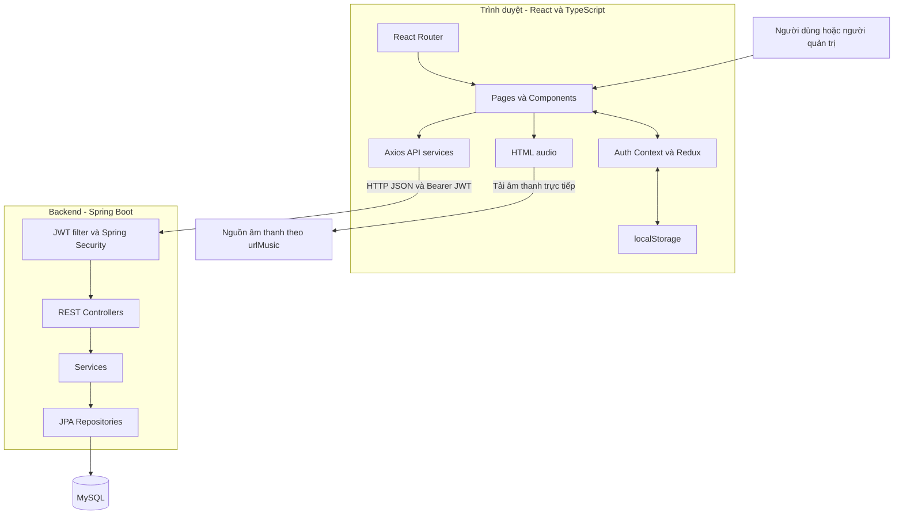

Backend quản lý metadata và nghiệp vụ; audio được trình duyệt tải theo URL. Nơi lưu file thực tế chưa được xác định từ kiến trúc hiện có. Không giả định MySQL lưu nội dung nhị phân nhạc hoặc backend đã có máy chủ streaming.

### 4.2. Sơ đồ phân rã chức năng — mục tiêu

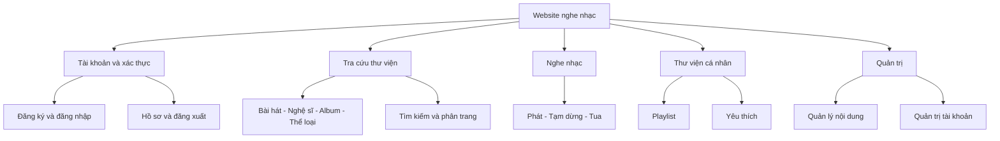

### 4.3. Sơ đồ triển khai phát triển — theo cấu hình

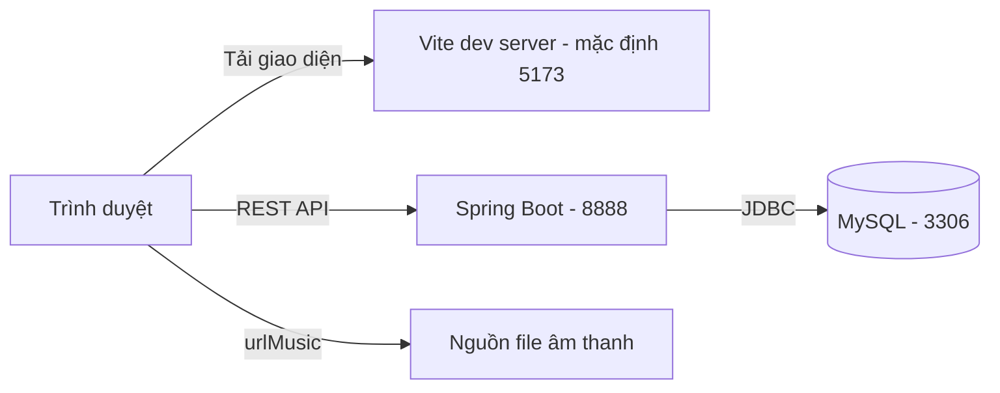

Frontend đặt baseURL localhost:8888/api; backend dùng database `do_an_tot_nghiep`. Sơ đồ phản ánh môi trường phát triển dự kiến, không xác nhận các dịch vụ đang chạy. Khi triển khai thật cần cấu hình domain, HTTPS, biến môi trường và nơi phục vụ file tĩnh; không dùng nguyên localhost cho máy người dùng.

## 5. Thiết kế dữ liệu

### 5.1. ERD logic — tái dựng từ entity hiện có

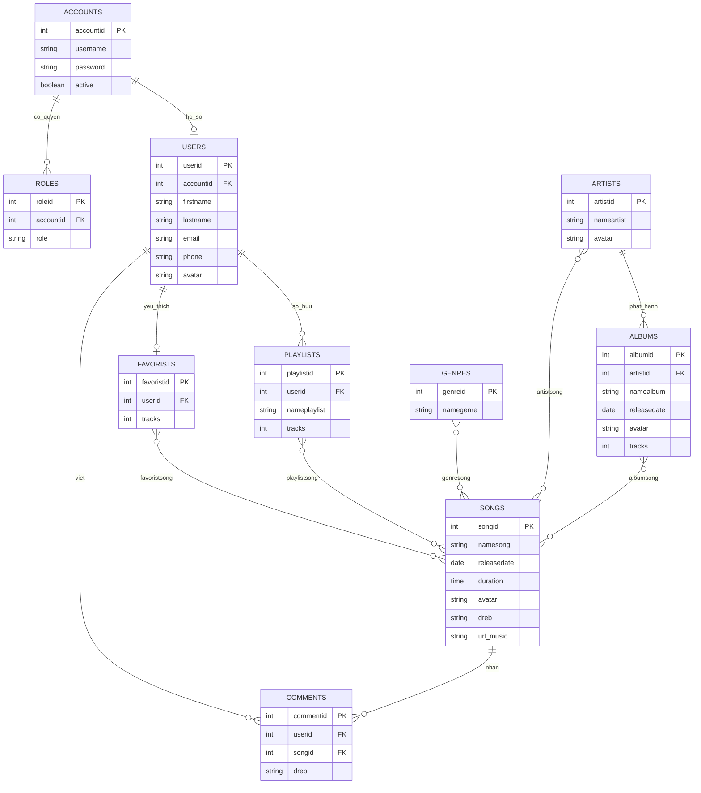

Đây là ERD logic; ký hiệu quan hệ thể hiện ý nghĩa nghiệp vụ suy ra từ annotation, không xác nhận NOT NULL/UNIQUE thực tế trong database. Các kiểu string/date/time mang tính mô tả; cần schema SQL thực tế để xác nhận độ dài, nullability và index. `dreb` là tên cột đang ánh xạ cho mô tả/nội dung. `password` phải lưu giá trị băm, không phải mật khẩu rõ.

### 5.2. Các bảng nối

| Bảng | Hai khóa ngoại | Ý nghĩa |
|---|---|---|
| artistsong | artistid, songid | Bài hát có thể có nhiều nghệ sĩ |
| genresong | genreid, songid | Bài hát có thể thuộc nhiều thể loại |
| albumsong | albumid, songid | Bài hát có thể nằm trong nhiều album theo code hiện tại |
| playlistsong | playlistid, songid | Nội dung playlist |
| favoristsong | favoristid, songid | Nội dung danh sách yêu thích |

Đề xuất ràng buộc duy nhất trên từng cặp khóa ngoại để tránh trùng liên kết. Nếu cần lưu thứ tự bài trong playlist, bổ sung thuộc tính vị trí và entity liên kết; mô hình hiện tại chưa có trường thứ tự rõ ràng.

### 5.3. Sơ đồ lớp miền rút gọn — hiện trạng

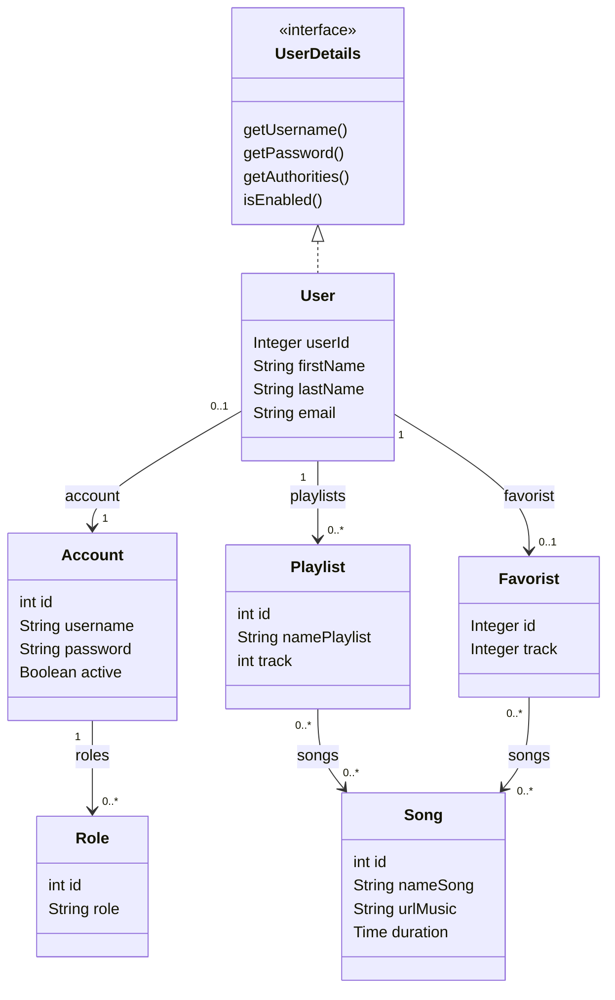

User triển khai UserDetails nhưng username/password/quyền được lấy từ Account và Role. Đây là điểm quan trọng khi mô tả xác thực: thông tin hồ sơ và thông tin đăng nhập nằm ở hai entity khác nhau. Sơ đồ rút gọn bỏ artist/album/genre/comment để tập trung vào tài khoản và thư viện cá nhân; các quan hệ còn lại nằm trong ERD.

## 6. Thiết kế luồng xử lý

### 6.1. Sơ đồ tuần tự đăng nhập — luồng thành công hiện có

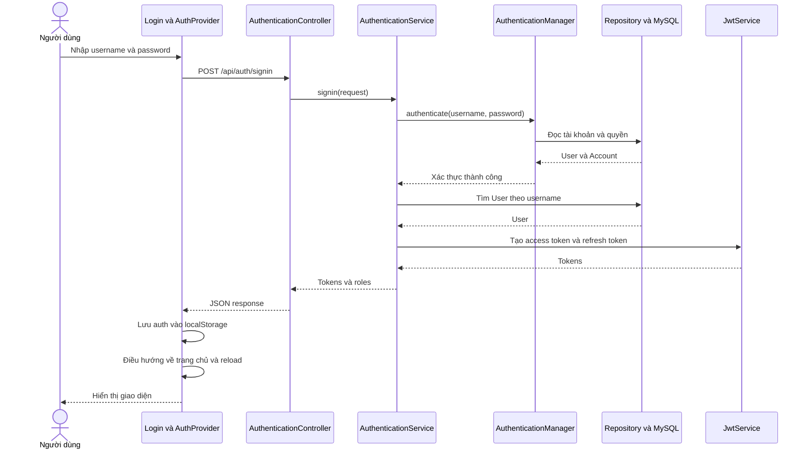

Luồng lỗi phải được bổ sung theo UC01; không coi xử lý lỗi hiện tại là đã đúng. Không vẽ quy trình refresh tự động vì chưa có đủ triển khai tương ứng.

### 6.2. Sơ đồ tuần tự nghe nhạc — hiện trạng rút gọn

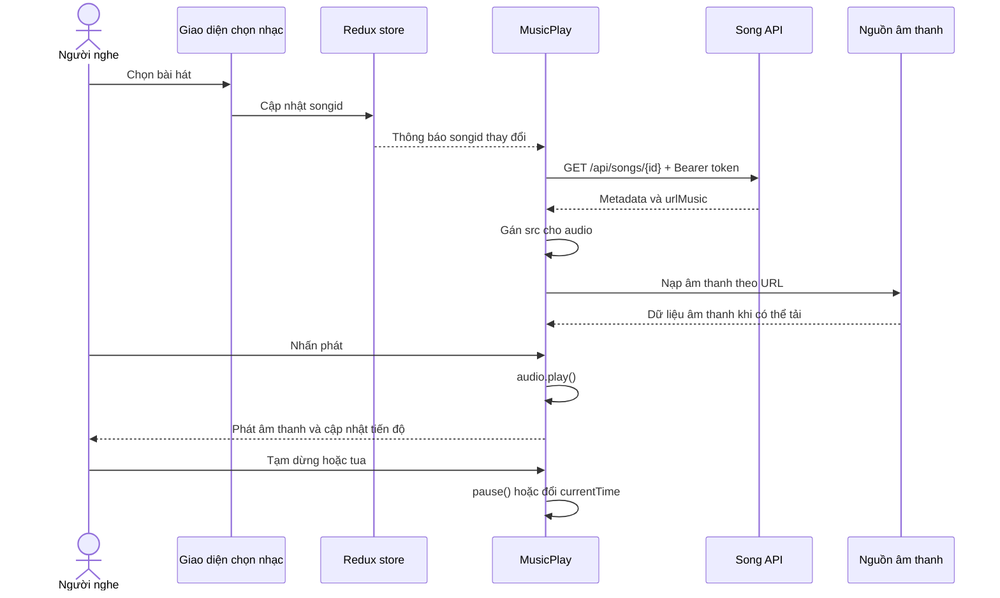

Chọn bài hát và nhấn phát là hai thao tác được tách trong mô tả; không mặc định bài hát tự phát ngay sau khi chọn.

### 6.3. Sơ đồ hoạt động thêm bài vào playlist — đề xuất

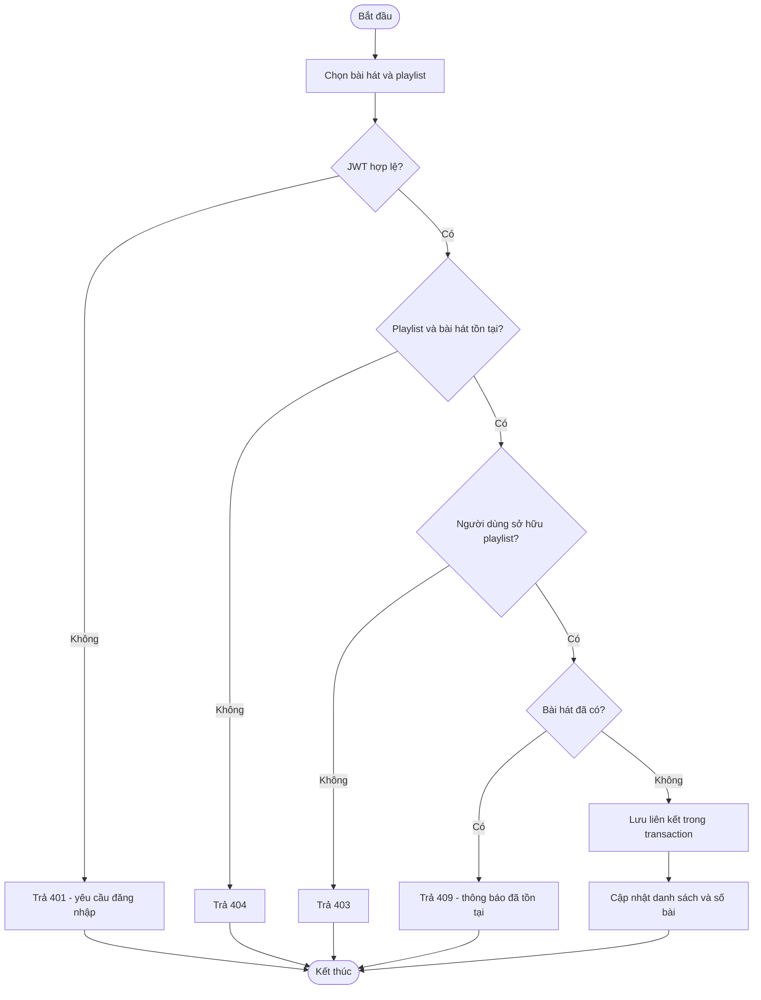

Sơ đồ bổ sung kiểm tra chủ sở hữu và transaction theo thiết kế mục tiêu; không khẳng định controller hiện tại đã thực hiện các bước này.

### 6.4. Sơ đồ tuần tự quản lý bài hát — thiết kế đề xuất

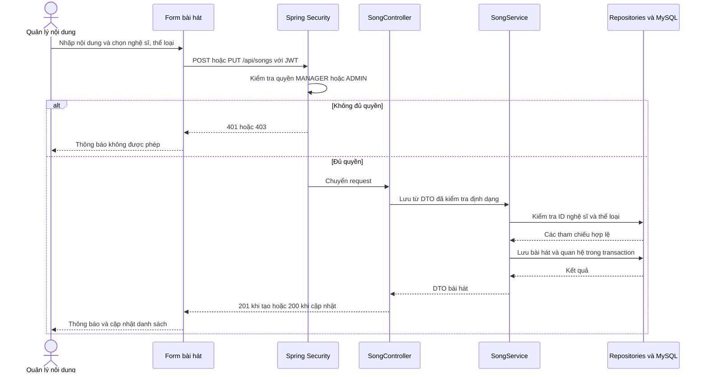

Nhánh thành công giả định tham chiếu hợp lệ; nếu không có artist/genre thì trả lỗi và không lưu dở dang. Hiện controller tự ghép quan hệ và trả entity; việc chuyển sang DTO/service transaction là đề xuất.

## 7. Thiết kế giao diện

### 7.1. Sơ đồ điều hướng

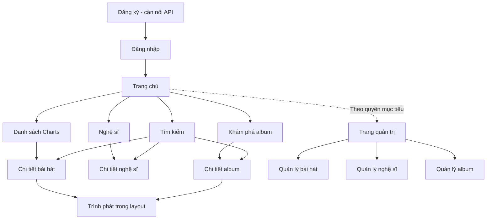

Sơ đồ mô tả cấu trúc điều hướng dự kiến từ các route/component, không khẳng định mọi liên kết đã nối hoàn chỉnh. Hiện route `/admin` chưa được bảo vệ ở frontend. Playlist và yêu thích cần bổ sung/hoàn thiện giao diện cá nhân; không vẽ chúng như các route độc lập đã có.

### 7.2. Yêu cầu giao diện đề xuất

- Giao diện người dùng giữ vị trí trình phát nhất quán khi chuyển trang.
- Kết quả tìm kiếm thể hiện từ khóa, trạng thái đang tải, không có kết quả và lỗi.
- Form quản trị kiểm tra trường bắt buộc, giữ dữ liệu khi lưu thất bại và xác nhận trước khi xóa.
- Các nút quản trị hiển thị theo quyền; backend vẫn kiểm tra mọi request.
- Điều khiển âm thanh có nhãn truy cập, dùng được bằng bàn phím; không phụ thuộc hoàn toàn vào biểu tượng.

## 8. Yêu cầu phi chức năng và thiết kế API

### 8.1. Yêu cầu phi chức năng — mục tiêu, chưa đo kiểm

| Nhóm | Tiêu chí đề xuất |
|---|---|
| Bảo mật | BCrypt, HTTPS khi triển khai, kiểm tra quyền và chủ sở hữu, không đưa token vào URL hoặc password vào response |
| Toàn vẹn | Khóa ngoại, chống trùng quan hệ, transaction cho thao tác nhiều bảng |
| Hiệu năng | Phân trang danh mục, giới hạn kích thước trang, kiểm tra truy vấn dư thừa; đo trước khi đặt mục tiêu tải |
| Độ tin cậy | Lỗi có cấu trúc, thông báo khi nguồn nhạc không truy cập được, không báo lưu thành công khi API thất bại |
| Khả dụng | Giao diện thích ứng màn hình; loading/empty/error state; hỗ trợ bàn phím |
| Bảo trì | Tách controller/service, DTO nhất quán, cấu hình theo môi trường, kiểm thử nghiệp vụ |

Không đưa con số người dùng đồng thời hoặc thời gian đáp ứng vào kết quả đồ án khi chưa có phép đo và cấu hình kiểm thử.

### 8.2. API đề xuất cho thư viện cá nhân

Các đường dẫn sau là thiết kế mới, chưa phải API hiện có:

| Method và endpoint | Ý nghĩa |
|---|---|
| GET `/api/me` | Lấy hồ sơ từ principal |
| PUT `/api/me` | Sửa hồ sơ bản thân |
| GET `/api/me/playlists` | Danh sách playlist của người hiện hành |
| POST `/api/me/playlists` | Tạo playlist thuộc người hiện hành |
| PUT `/api/playlists/{id}` | Đổi tên, có kiểm tra chủ sở hữu |
| POST `/api/playlists/{id}/songs` | Thêm bài hát qua body chứa songId |
| DELETE `/api/playlists/{id}/songs/{songId}` | Bỏ bài hát khỏi playlist |
| GET `/api/me/favorites/songs` | Đọc yêu thích cá nhân |
| PUT `/api/me/favorites/songs/{songId}` | Thêm yêu thích, có thể thiết kế idempotent |
| DELETE `/api/me/favorites/songs/{songId}` | Bỏ yêu thích |

Khi triển khai cần cập nhật đồng thời service frontend và backend; không đổi riêng tên `favorists` rồi để client cũ gọi đường dẫn không còn tồn tại. Có thể giữ API cũ tạm thời nếu cần tương thích.

## 9. Định hướng kiểm thử và hoàn thiện

### 9.1. Kịch bản nghiệm thu cốt lõi

| Mã | Kịch bản | Kết quả mong đợi |
|---|---|---|
| AT01 | Đăng nhập đúng/sai hoặc tài khoản vô hiệu | Chỉ tài khoản hợp lệ vào được hệ thống |
| AT02 | CUSTOMER gọi API tạo/xóa bài hát | Bị từ chối; dữ liệu không thay đổi |
| AT03 | Khách gọi API user/account quản trị | Bị từ chối; không lộ hồ sơ/password hash |
| AT04 | Tìm kiếm có/không có kết quả | Danh sách và trạng thái rỗng đúng |
| AT05 | Phát, tạm dừng, tua một URL hợp lệ | Âm thanh và thời gian hiển thị đồng bộ |
| AT06 | URL nhạc hỏng | Thông báo rõ, giao diện không treo |
| AT07 | Thêm trùng hoặc sửa playlist người khác | Không trùng liên kết; không sửa trái quyền |
| AT08 | Tạo/sửa bài hát có artist/genre không tồn tại | Báo lỗi, không lưu một phần |
| AT09 | Logout rồi tiếp tục gọi API | Client không gửi token cũ; quyền server theo chính sách JWT đã thiết kế |
| AT10 | Đăng ký qua giao diện | Tạo được tài khoản CUSTOMER và không tự chọn quyền quản trị |

### 9.2. Thứ tự hoàn thiện đề xuất

1. Khôi phục môi trường phát triển và dữ liệu mẫu; chạy build/lint/test để có đường cơ sở.
2. Sửa quyền user/account, response chứa dữ liệu xác thực, cấp role khi đăng ký và guard quản trị.
3. Hoàn thiện đăng ký/đăng nhập/logout và thống nhất xử lý lỗi API.
4. Đồng bộ hợp đồng playlist/yêu thích, bỏ user ID cố định, bổ sung kiểm tra chủ sở hữu.
5. Chuẩn hóa DTO, validation, transaction và quan hệ JPA; kiểm tra xóa dữ liệu liên quan.
6. Kiểm thử các luồng nghe nhạc và quản trị, chụp giao diện thực tế; cập nhật sơ đồ theo phiên bản đã hoàn thiện.
7. Chỉ bổ sung bình luận, thống kê hoặc tính năng gợi ý khi phạm vi đồ án còn cho phép.

## 10. Gợi ý đưa vào báo cáo đồ án

- **Chương 1 — Tổng quan:** bối cảnh, mục tiêu, phạm vi, đối tượng sử dụng; lấy nền từ mục 1.
- **Chương 2 — Cơ sở công nghệ:** React, TypeScript, Spring Boot, REST, JWT, JPA, MySQL; bổ sung tài liệu tham khảo chính thức khi viết bản nộp.
- **Chương 3 — Phân tích và thiết kế:** yêu cầu, use case, kiến trúc, ERD, lớp, tuần tự, hoạt động và giao diện từ mục 2–8.
- **Chương 4 — Cài đặt và kiểm thử:** mô tả phiên bản thực sự chạy được, ảnh màn hình, dữ liệu thử và kết quả nghiệm thu; chưa thể hoàn tất chỉ bằng phân tích mã.
- **Chương 5 — Kết luận:** các chức năng thực tế đạt được, hạn chế còn tồn tại và hướng phát triển.

### Nguồn mã để đối chiếu

- Backend: `pom.xml`; `entity/*.java`; `controller/*.java`; `security/config/SecurityConfiguration.java`; `service/impl/AuthenticationServiceImpl.java`; `src/main/resources/application.properties`.
- Frontend: `package.json`; `src/App.tsx`; `src/server/`; `src/hooks/AuthProvider.tsx`; `src/store/playingMusic/playingMusicSlice.tsx`; `src/components/footer/MusicPlay.tsx`; `src/components/common/Menu.tsx`; `src/components/login/SignUp.tsx`.
- Phần tổng quan cấu trúc và hướng dẫn chạy nằm ở đầu README này.

**Giới hạn bản phác thảo:** chưa kết nối database thực tế, chưa chạy ứng dụng hoặc đo hiệu năng. Các sơ đồ đề xuất cần được cập nhật theo yêu cầu cuối cùng và kết quả triển khai; không dùng chúng để khẳng định các chức năng chưa hoàn thiện đã tồn tại.
